# ADO in Excel

A modern replacement for Microsoft’s [Azure DevOps Open in Excel](https://marketplace.visualstudio.com/items?itemName=blueprint.vsts-open-work-items-in-excel) extension.

The original marketplace extension only launched Excel. The actual round-trip editing lived in the **Azure DevOps Office Integration** COM add-in (`tfs://ExcelRequirements/...`). Microsoft no longer supports that add-in, it is Windows-only, and it is unreliable with current Office, browsers, and multifactor authentication.

This repo keeps the same Azure DevOps entry points and replaces the COM add-in with an **Office.js Excel add-in**.

## Target platform

**Excel for Windows (Microsoft 365)** is the supported target. That is the audience the original product served, and it is where Office.js ribbon commands, sideloading, and Azure DevOps REST access are most predictable.

Excel for Mac is not a design target. The Office.js add-in may load there because the platform is the same, but Mac-specific launchers, installers, and protocol handlers are intentionally out of scope. The blocking Mac problem is not Excel itself — it is that the old `tfs://` COM protocol never existed on macOS, and browser-to-Excel auto-launch is still a poor experience there.

## How it works

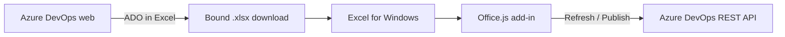


1. In Azure DevOps, **ADO in Excel** on a saved query, query results toolbar, or work item context menu opens a dialog that builds a bound workbook. Click **Download workbook**, then open the file. The browser cannot launch Excel.
2. Open that file in Excel. The data is already in a worksheet, so you can analyze it immediately. The binding metadata sheet stays hidden.
3. Sideload the Excel add-in. Connect with **Sign in with Microsoft** (Entra ID) or a Personal Access Token. Under **Connection**, you can also pick a project and **Load query**.
4. **Refresh** reloads current values. **Publish** writes changed fields and parent/child links back (with progress for larger batches), creates new rows that have no ID, and reports revision conflicts. Types, states, picklists, and area/iteration paths come from the project's process template. **View in Browser** opens the selected work item in Azure DevOps. The task pane also lists related links, attachments, and discussion for that row.

The original Microsoft DevLabs extension source can be kept locally under `legacy/` for reference (gitignored; not part of the published product).

## Feature parity

The legacy **marketplace extension** only launched Excel via `tfs://`. Bulk edit, publish, refresh, columns, and tree lists lived in the separate **Azure DevOps Office Integration** COM add-in (Team ribbon). That COM surface is undocumented in this repo; the table below compares known Team-ribbon / product behavior with this Office.js replacement.


| Capability                             | Legacy (extension + COM)                          | This version                                                                                                              |
| -------------------------------------- | ------------------------------------------------- | ------------------------------------------------------------------------------------------------------------------------- |
| Open a saved query from Boards         | Yes — `tfs://` into Excel                         | Yes — downloads a bound workbook (**ADO in Excel**)                                                                       |
| Open selected work items               | Yes                                               | Yes                                                                                                                       |
| Launch Excel from the browser          | Yes — protocol handler                            | No — download `.xlsx`, open in Excel for Windows                                                                          |
| Bulk edit in Excel                     | Yes                                               | Yes                                                                                                                       |
| Publish changes back to Azure DevOps   | Classic Team ribbon                               | Office.js **Publish**                                                                                                     |
| Refresh from Azure DevOps              | Classic Team ribbon                               | Office.js **Refresh**                                                                                                     |
| Create work items by adding rows       | Yes                                               | Yes — **Insert work item**, or blank ID with **Work Item Type** and **Title**                                             |
| Choose / reorder columns               | Yes                                               | Yes — staged add, remove, and reorder, applied in one step; ID, Type, Title, and Rev stay                                 |
| Parent Title column                    | No (parent via tree / links)                      | Yes — optional read-only column; resolved from the parent work item                                                       |
| Area / Iteration path pickers          | Yes                                               | Yes — task pane tree plus Excel dropdowns from the project                                                                |
| Picklists and valid states             | Yes                                               | Yes — dropdowns from the process template; publish validates transitions                                                  |
| HTML fields (Description, Repro Steps) | Rich text in Excel                                | Markdown in the cell (converted to HTML on publish). If the cell already contains HTML tags, that HTML is published as-is |
| Conflict detection                     | Yes                                               | Yes, using `System.Rev`                                                                                                   |
| Tree / parent-child lists              | Yes — Title 1…N columns                           | Yes — one **Title** column with Excel indent, outline grouping, row shading, Indent/Outdent                               |
| Identity pickers                       | Yes                                               | Yes — in-cell dropdown on Assigned To; sidebar search for people not on the project teams                                 |
| View in Browser                        | Team ribbon / ID hyperlink                        | Yes — ID hyperlink, Home ribbon, cell context menu, and task pane                                                         |
| Related links, attachments, discussion | Work item form / Team Explorer (limited in Excel) | Yes — selected-item task pane (parent/child via Title indent)                                                             |
| Microsoft Entra ID sign-in             | Unreliable / PAT fallback                         | Yes, with PAT fallback                                                                                                    |
| Built-in / unsaved queries             | Not supported                                     | Not supported (same exclusion list)                                                                                       |
| Azure DevOps Server (on-prem)          | Supported via Office Integration                  | Not a design target (cloud org URL + Entra/PAT)                                                                           |
| macOS / Excel for Mac                  | Not supported                                     | Not a supported target                                                                                                    |
| Large multi-item open                  | URL length limit (~2000 chars on `tfs://`)        | No protocol URL limit; workbook download                                                                                  |


**Intentional differences:** download instead of auto-launch; Markdown instead of Excel rich text; single Title + indent instead of Title 1…N; Entra as a first-class sign-in path.

---


## Screenshots


### Excel Overview

Excel displays hierarchy (i.e., tree queries) with the child nodes indented and provides highlighting to allow for quickly identifying the relative level.

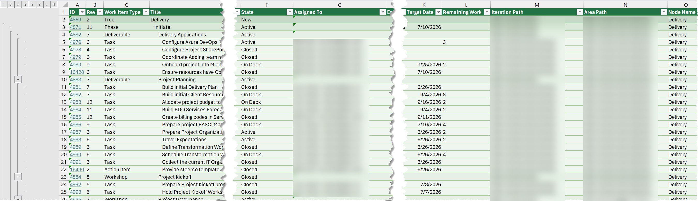

### Connection

Initial connection is via URL, and Entra or PAT authentication. Once connected the project and required query can be selected.

The add-in remembers the last connection and reconnects in the background when the task pane opens. To switch organizations, enter the new URL and PAT (or sign in) and click **Connect**; the project and query lists reload for the new organization. A sheet stays tied to the organization it was loaded from: Refresh, Publish, and the selected-item actions are blocked while you are connected elsewhere, and the workbook status says which organization to connect to. Requests that get no response time out after 60 seconds.

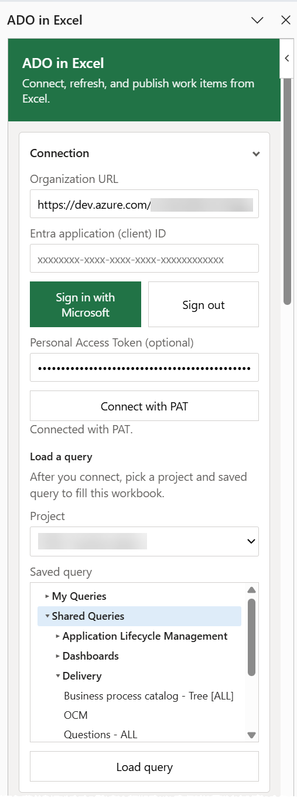

### This workbook

Refresh (pull from ADO) and Publish (pushing changes to ADO) can be accomplished in the Excel ribbon or sidebar under This workbook. When the sheet came from a saved query, **Open query in Azure DevOps** opens that query's results in the browser.

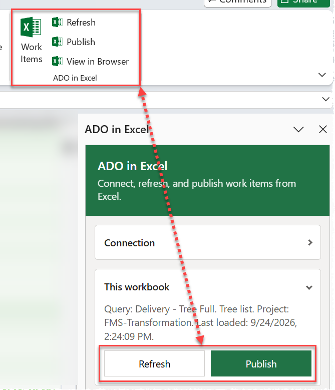

### Selected work item

The Selected work item allows you to open the work item you have the focus on in an Excel row (also available as a hyperlinked ID) and load additional details such as related links, parent ID and name, add/view/remove links of any work item link type (Related, Predecessor/Successor, Duplicate, Tested By, and more), add hyperlinks, add/view/remove attachments, etc.

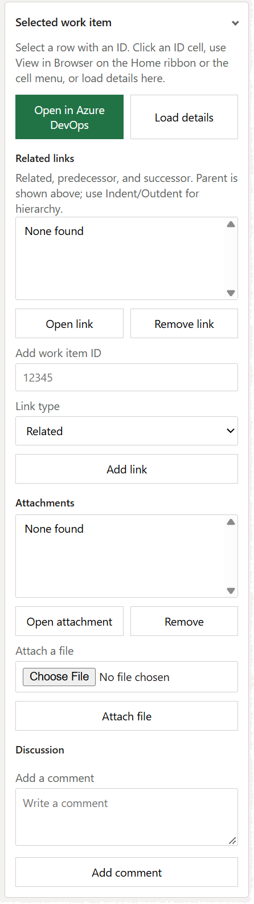

### Insert work item

Provides an alternative means of adding new work items.

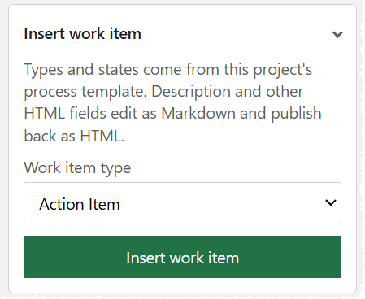

### Columns

Add/remove/re-order displayed columns (does not alter underlying query). Changes are staged in the task pane: move columns (Top, Up, Down, Bottom, or Alt+Up/Down), remove them, or add several fields at once below the selected column, then click **Apply changes** to rewrite the sheet once. New columns are filled from Azure DevOps when applied. **Discard** throws the pending changes away.

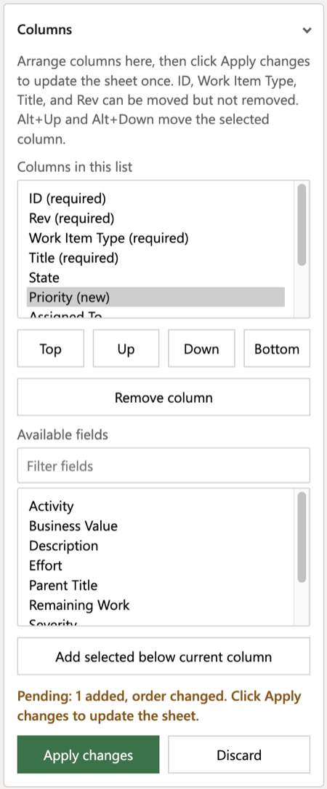

### Tree list

Provides alternative controls for editing parent/child relationships or converting a flat query to tree structure prior to adding children via Excel.

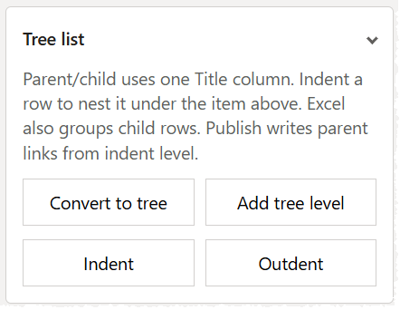

### Area and Iteration

Alternative means of adding/changing associated area or iteration for the selected work item.

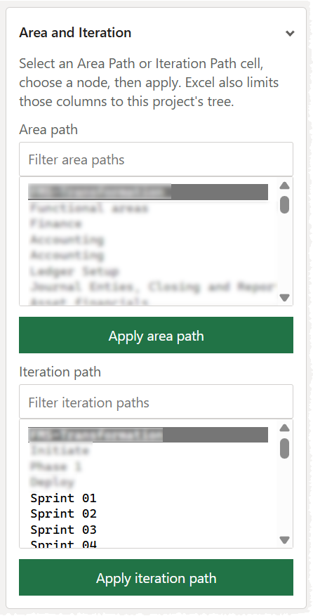

### Assigned To

Alternative means of changing resource assigned to a work item (primary would be in the row via the picklist).

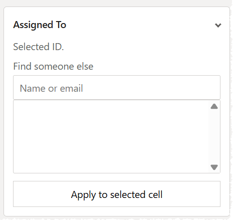

### Status

Simple status returned on refresh, publish, and other actions.

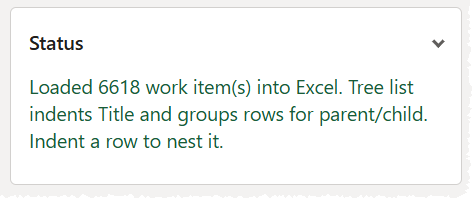

---


## Repository layout

- `packages/ado-extension` — Azure DevOps marketplace extension (the **ADO in Excel** commands)
- `packages/excel-addin` — Office.js Excel add-in (Connect, Refresh, Publish, View in Browser, selected-item links/attachments/discussion)
- `packages/shared` — workbook metadata, process catalog, field flattening, publish diffing, REST client
- `legacy/` — optional local copy of the original Microsoft DevLabs extension (gitignored)


## Prerequisites

- Node.js 18+
- Excel for Windows (Microsoft 365 recommended)
- An Azure DevOps organization
- Either:
  - A PAT with **Work Items (Read, write, & manage)** and **Identity (Read)** (`vso.work_write`, `vso.identity`), or
  - A Microsoft Entra app registration with delegated **Azure DevOps user_impersonation**
- A marketplace publisher ID if you will pack the Azure DevOps extension (`publisher` is `BillCurtisADOTools` in `packages/ado-extension/vss-extension.json`)


## Development

```bash
npm install
npm test
npm run build
```

### Excel add-in manifests

There are two manifests with different add-in IDs, so both can be installed at the same time without replacing each other:

| Manifest | Loads from | Add-in ID | Shows in Excel as |
| --- | --- | --- | --- |
| `packages/excel-addin/manifest.xml` | `https://bcurtisbdo.github.io/ADOExcel/` (no local server needed) | `7e3c9d2a-6b14-4f8e-9c31-2a5d8e7f0b19` | **ADO in Excel** |
| `packages/excel-addin/manifest.dev.xml` | `https://localhost:3001/` (local dev server) | `67d9cc9b-b2f9-434f-ad07-ec33be30a033` | **ADO in Excel (Dev)** |

Install the hosted add-in in Excel without running anything locally:

```bash
npm run sideload:addin
```

Remove it again with `npm run unsideload:addin`. You can also add `packages/excel-addin/manifest.xml` by hand from **Insert > My Add-ins > Upload My Add-in** (Windows) or by copying it into `~/Library/Containers/com.microsoft.Excel/Data/Documents/wef/` (Mac).

To work on the add-in code, run the dev version against the local server:

```bash
npm run start:addin
```

That serves the add-in at `https://localhost:3001` and installs `manifest.dev.xml` (version **1.2.0.0**). Trust the local HTTPS certificate if prompted. In Excel, the **ADO in Excel (Dev)** group on the Home ribbon opens the task pane, refreshes, publishes, and opens the selected work item in the browser. Stop it with `npm run stop:addin`; the hosted **ADO in Excel** add-in is unaffected. After a version bump, stop and restart `npm run start:addin` so Excel reloads the manifest.

If Excel shows **WebView Stop On Load** (debug attach prompt), that is from `office-addin-debugging` enabling WebView debugging—not from production. To avoid it:

- Prefer `npm run start:addin:nodebug` (sideload without the debugger), or
- Clear the dev add-in’s developer flags in the registry under `HKCU\Software\Microsoft\Office\16.0\WEF\Developer\67d9cc9b-b2f9-434f-ad07-ec33be30a033` (`UseDirectDebugger`, `UseLiveReload`, and `UseWebDebugger` set to `0`), then restart Excel.

Clicking **Cancel** on the dialog only skips it for the current add-in instance; it returns after a restart if debug flags are still on.

### Azure DevOps extension

The packaged extension (`npm run package:ado`) bundles its pages inside the `.vsix`, so it does not need a local server. To iterate on the extension code against a local server instead:

```bash
npm run start:ado
```

Then pack it with the dev override (`baseUri: https://localhost:3000`) and share it to your Azure DevOps organization:

```bash
npx tfx extension create --manifest-globs vss-extension.json --overrides-file configs/dev.json
```

Run that from `packages/ado-extension` after `npm run build` in that package. Upload the `.vsix` as a shared (private) extension to test the **ADO in Excel** commands against the local webpack server.

## Using it

1. In Excel, open the task pane and enter `https://dev.azure.com/<org>`.
2. Sign in with Microsoft (work or school account), or paste a PAT and **Connect with PAT**.
3. Open a workbook generated from Azure DevOps, or under **Connection** pick a project and a saved query from the folder tree and click **Load query**. The sheet stays bound after load, so Publish and Refresh work without downloading again. Tree queries use one **Title** column; the add-in indents and groups child rows and shades each nest level. Date columns show as short dates, and cells are top-aligned. If you opened a downloaded file, click **Enable Editing** first.
4. Edit cells. Use **Insert work item** to add a process type, or leave **ID** blank to create a row. Indent a row to nest it under the item above.
5. Add or reorder columns from the process field list, then click **Apply changes**. ID, Work Item Type, Title, and Rev cannot be removed.
6. For Area Path or Iteration Path, select the cell, choose a node, and apply. For Assigned To, use the Excel dropdown on the cell. Search in the task pane only if the person is not listed.
7. Click an **ID** cell, use **View in Browser** on the Home ribbon or the cell menu, or **Open in Azure DevOps** in the task pane. **Load details** shows related links, attachments, and discussion for that row. Parent/child uses Title indent.
8. HTML fields such as Description edit as Markdown; publish converts Markdown to HTML. If you paste HTML into the cell instead (tags such as `div`, `p`, `br`, `b`, `a`), that HTML is published as-is. Unchanged values that still match the workbook snapshot are not rewritten.
9. **Publish**, then **Refresh** if you need to pick up other people's changes.

Do not commit PATs or access tokens. The add-in stores the PAT (if used) and Entra account hint in Office runtime storage on the local machine.

### View in Browser

Select a work item row that already has an ID, then open it in Azure DevOps from any of:

- the **ID** hyperlink on the sheet
- **View in Browser** on the Home ribbon **ADO in Excel** group
- **View in Browser** on the cell context menu
- **Open in Azure DevOps** in the task pane

New rows without an ID must be published first. To open the saved query behind the sheet, use **Open query in Azure DevOps** under **This workbook**.

### Selected work item (links, attachments, discussion)

Excel stays a grid for bulk field edit. Related links, attachments, and discussion live in the **Selected work item** task pane, not extra columns.

1. Select a row with an ID and click **Load details**.
2. Links can be opened, added by work item ID, or removed. **Link type** lists every work item link type your organization allows, grouped as Related, Dependency (Predecessor, Successor), Duplicate, Test (Tested By, Tests), Affects (CMMI), and custom types. Parent/child uses Title indent on publish; links to other organizations and Test Plans' shared step links are managed in Azure DevOps. **Add hyperlink** adds a web (http or https) link with an optional comment. Commit, branch, and build links are listed but open from the work item in Azure DevOps.
3. Attachments can be listed, added, or removed. Download files from the work item in Azure DevOps (**Open work item**); attachment REST URLs often fail in the browser when you are connected with a PAT.
4. Discussion lists recent comments and can add a comment.

Add and remove act on the work item shown in the panel. If you select a different row, click **Load details** again first; otherwise the action stops with a message rather than changing the wrong work item. Removing a link or attachment also fails safely if the work item changed since its details were loaded. The panel clears when you load a query, refresh, publish, or connect.


### Tree lists

- Tree queries from Azure DevOps download with a single **Title** column. Opening the add-in indents titles, groups child rows from the saved parent links, and shades each nest level (darker at the root, lighter deeper).
- **Convert to tree** turns a flat list into an indent list so you can add children.
- **Indent** / **Outdent** change nesting. Publish creates or updates `Hierarchy-Reverse` (parent) links from indent level (the previous shallower row). Older workbooks that still have Title 1, Title 2, … can be read; writes keep a single Title column.
- To reparent in bulk, rearrange rows so the new parent is the nearest shallower row above each child, set indent, then **Publish**. To move items between areas or iterations, edit those columns on many rows and **Publish**.


### Process template

After you load a query, the add-in reads work item types, states, transitions, picklists, and classification nodes from Azure DevOps and caches them in the workbook. Dropdowns are applied after the grid is written so they remain on State, Assigned To, Work Item Type, and other process fields.

- Excel dropdowns restrict Work Item Type, State, picklists, Area Path, and Iteration Path.
- Publish rejects values that are not valid for this project's process, including illegal state transitions.
- Publish rejects a changed Work Item Type on an existing row. Excel can't change a work item's type; do that in Azure DevOps, or set the cell back.
- Suggested picklists warn instead of blocking when you type a value that is not on the list.


### Entra ID app registration

Needed only for **Sign in with Microsoft**. If you use **Connect with PAT** only, you do not need an Entra app registration or a redirect URI.

1. In the Azure portal, register a **single-page application**.
2. Add SPA redirect URIs `https://bcurtisbdo.github.io/ADOExcel/auth.html` (hosted add-in) and `https://localhost:3001/auth.html` (dev add-in, only if you develop locally).
3. Add delegated permission **Azure DevOps → user_impersonation**.
4. Supported account types: organizational directory (and personal accounts only if your org allows it; Azure DevOps REST via Entra is intended for work/school accounts).
5. Paste the Application (client) ID into the Excel task pane, then **Sign in with Microsoft**.


## Production deployment

The Excel add-in is an **Office.js web add-in** (XML manifest + HTTPS-hosted pages). It is not a signed COM/VSTO binary; there is no Authenticode package to publish.

1. Run `npm run build`. `packages/excel-addin/manifest.xml` already points every URL at `https://bcurtisbdo.github.io/ADOExcel/` (and `AppDomain` `https://bcurtisbdo.github.io`); the build copies it to `dist/manifest.xml` unchanged. To host somewhere else, update the URLs in `manifest.xml`.
2. Publish the contents of `packages/excel-addin/dist` so they are served from `https://bcurtisbdo.github.io/ADOExcel/` (for example, `taskpane.html` at `https://bcurtisbdo.github.io/ADOExcel/taskpane.html`).
3. Distribute `manifest.xml` (not `manifest.dev.xml`) to users:
  - **Organization:** Microsoft 365 admin **Integrated apps** (or Centralized Deployment)—upload the XML or a URL to it; assign users or groups.
  - **Public:** Microsoft Marketplace (AppSource), after validation.
4. Pack the Azure DevOps extension with `npm run package:ado` and publish or privately share it. That extension downloads workbooks; Excel still needs the Office add-in for Publish, Refresh, and the task pane.

For Entra sign-in in production, add `https://bcurtisbdo.github.io/ADOExcel/auth.html` as a redirect URI on the app registration. PAT-only tenants skip that step.

See [CHANGELOG.md](CHANGELOG.md) for release notes.

